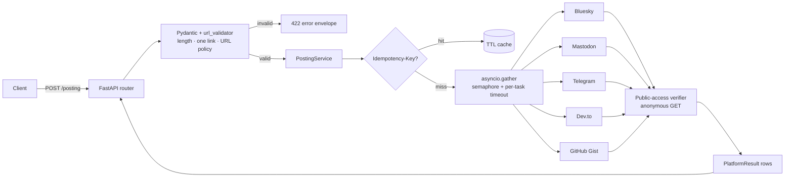

# Automated Multi-Platform Posting System

A FastAPI service that validates **one** short message and publishes it to **five** third-party
platforms through their official APIs — concurrently, with per-platform error isolation, retries,
timeouts and an anonymously verified public URL in every result row.

[](https://github.com/powerxranger/automated-multi-platform-posting/actions/workflows/ci.yml)


```
POST http://localhost:4000/posting
{ "message": "Check out our latest business platform ... https://example.com" }
```

---

## Contents

- [What it does](#what-it-does)
- [Architecture](#architecture)
- [Quickstart](#quickstart)
- [Configuration](#configuration)
- [The five integrations](#the-five-integrations)
- [API reference](#api-reference)
- [Validation rules](#validation-rules)
- [Live test results](#live-test-results)
- [Tests](#tests)
- [Design decisions](#design-decisions)
- [Error handling](#error-handling)
- [Security](#security)
- [Limitations](#limitations)
- [Project structure](#project-structure)

---

## What it does

| Requirement | Implementation |
|---|---|
| One REST endpoint | `POST /posting` (plus `/platforms`, `/health`, `/validate`) |
| Message ≤ 200 chars | Normalised, then counted in characters (`message_too_long`) |
| Exactly one CTA link | Counted by URL extraction (`link_count`) |
| URL validation | scheme, hostname, TLD, port, embedded credentials, private/loopback IPs (`invalid_url`) |
| Platform selection internal | `ENABLED_PLATFORMS` env var — never a request field |
| ≥ 5 platforms, independent | **5** adapters, 5 distinct auth mechanisms |
| One failure must not stop the rest | `asyncio.gather` + per-task timeout, retry and exception containment |
| Result per platform | platform, status, posted URL, public access, date, time, error |

**Five different authentication mechanisms:** AT Protocol session JWT (Bluesky), Bearer token
(Mastodon), Bot token (Telegram), `api-key` header (Dev.to), fine-grained PAT (GitHub Gist).

**`public_access` is measured, not assumed.** After publishing, the service fetches the URL
*without credentials* and looks for login-wall signals. No mock data is returned by the real
endpoint — a platform without credentials is reported as *unavailable*, never as a success.

---

## Architecture



**Layering.** Adapters contain *only* platform specifics. The service contains *only*
orchestration. Validation is a set of pure functions. An adapter bug can never break another
platform, and every business rule is unit-testable without a network.

**Reliability defaults**: 15 s per-platform timeout, 5 concurrent posts, 1 retry for transient
failures only (429 / 5xx / timeout / connection error), exponential backoff with jitter, honouring
`Retry-After`.

---

## Quickstart

Requires **Python 3.11+**.

```bash
git clone https://github.com/powerxranger/automated-multi-platform-posting.git
cd automated-multi-platform-posting

python -m venv .venv
# Windows
.venv\Scripts\activate
# macOS / Linux
source .venv/bin/activate

pip install -r requirements.txt

# Windows: Copy-Item .env.example .env
cp .env.example .env
# ... fill in the five sets of credentials, then:

uvicorn app.main:app --host 0.0.0.0 --port 4000
```

Open **http://localhost:4000/docs** for Swagger UI.

```bash
python scripts/check_env.py      # 5 of 5 platforms ready
curl http://localhost:4000/platforms
```

```bash
curl -X POST http://localhost:4000/posting \
  -H "Content-Type: application/json" \
  -d '{"message":"Check out our latest business platform and grow your online visibility. https://example.com"}'
```

Docker (optional): `docker compose up --build`.

---

## Configuration

Every credential is optional. With none configured, `POST /posting` returns
`503 NO_PLATFORMS_CONFIGURED` listing what is missing.

| Variable | Purpose | Default |
|---|---|---|
| `APP_TIMEZONE` | Timezone for `date` / `time` fields | `Asia/Kolkata` |
| `ENABLED_PLATFORMS` | Comma-separated ids to use; empty = all configured | *(empty)* |
| `REQUEST_TIMEOUT_SECONDS` | Per-platform deadline | `15` |
| `MAX_CONCURRENT_PLATFORMS` | Parallel posts | `5` |
| `MAX_RETRIES` | Retries for transient failures only | `1` |
| `PUBLIC_CHECK_ENABLED` | Verify posted URLs anonymously | `true` |
| `IDEMPOTENCY_TTL_SECONDS` | `Idempotency-Key` cache lifetime | `600` |

See [`.env.example`](.env.example) for the full annotated list.

---

## The five integrations

| # | Platform | Auth | Public post URL | Credentials |
|---|---|---|---|---|
| 1 | **Bluesky** | `createSession` → JWT | `bsky.app/profile/{handle}/post/{rkey}` | `BLUESKY_HANDLE`, `BLUESKY_APP_PASSWORD` |
| 2 | **Mastodon** | Bearer token | `{instance}/@{user}/{id}` | `MASTODON_INSTANCE_URL`, `MASTODON_ACCESS_TOKEN` |
| 3 | **Telegram** | Bot token (public channel admin) | `t.me/{channel}/{message_id}` | `TELEGRAM_BOT_TOKEN`, `TELEGRAM_CHANNEL` |
| 4 | **Dev.to** | `api-key` header | `dev.to/{user}/{slug}` | `DEVTO_API_KEY` |
| 5 | **GitHub Gist** | Fine-grained PAT (`Gists`) | `gist.github.com/...` | `GITHUB_TOKEN` |

### Getting credentials

1. **Bluesky** — bsky.app → *Settings* → *App Passwords* → add one. Use an **app password**,
   not your account password. No developer account or approval.
2. **Mastodon** — *Preferences* → *Development* → *New application*, scope **`write:statuses`**.
   Set `MASTODON_INSTANCE_URL` to the exact instance domain with `https://`.
3. **Telegram** — `@BotFather` → `/newbot` → token. Create a **public** channel with a `@username`,
   then add the bot as **administrator** with *Post Messages*. `TELEGRAM_CHANNEL` accepts
   `@name`, `name` or `https://t.me/name`.
4. **Dev.to** — *Settings* → *Extensions* → *DEV Community API Keys* → generate. Each article
   needs a **unique** CTA link, because it is sent as the canonical URL.
5. **GitHub Gist** — *Settings* → *Developer settings* → *Personal access tokens* →
   **fine-grained** token with **Account permissions → Gists: read and write**.

### Platforms deliberately not implemented

Medium discontinued its public write API; Threads/Pinterest/Facebook need app review; Slack and
Discord posts are not publicly readable; Buffer/Ayrshare are aggregators rather than direct
integrations.

---

## API reference

### `POST /posting`

| | |
|---|---|
| Body | `{"message": string}` — `extra` fields rejected with `422` |
| Optional header | `Idempotency-Key: <string>` — same key within 10 min returns the cached response |
| `200` | At least one platform published (`success: true`); `summary` carries the detail |
| `422` | Validation failed — structured `fields[]` |
| `503` | No platform configured |
| `500` | Unexpected server error (never leaks internals) |

Result fields: **`platform`, `status`, `posted_url`, `public_access`, `date`, `time`, `error`**
— exactly as specified — plus a nested `meta` object with `http_status`, `latency_ms`, `attempts`,
`public_access_verified`, `timezone`, `post_id` and `checked_at_utc`.

### Other endpoints

| Endpoint | Purpose |
|---|---|
| `GET /health` | Liveness + how many platforms are configured |
| `GET /platforms` | Readiness report: configured, enabled, required-but-missing variables |
| `POST /validate` | Dry run of the validation rules (no publishing), always `200` |
| `GET /docs`, `GET /redoc`, `GET /openapi.json` | Interactive documentation |

---

## Validation rules

Applied to the whitespace-normalised message, in this order.

| Rule | Failure code | Example message |
|---|---|---|
| Not empty | `message_empty` | `Message must not be empty.` |
| ≤ 200 characters | `message_too_long` | `Message is 231 characters; the maximum is 200.` |
| Exactly one link | `link_count` | `Exactly one CTA link is required; none was found.` |
| Link is `http`/`https` | `invalid_url` | `The CTA link is invalid: only http and https URLs are supported.` |
| Hostname has a TLD | `invalid_url` | `... 'example' is not a valid top-level domain` |
| No embedded credentials | `invalid_url` | `... credentials embedded in the URL are not allowed` |
| No private / loopback host | `invalid_url` | `... private or reserved IP addresses are not publicly reachable` |
| Valid port | `invalid_url` | `... the URL contains an invalid port` |

Trailing punctuation is stripped (`(https://example.com).` → `https://example.com`). Character
counting is by Unicode code point.

---

## Live test results

Real `POST /posting` run against all five configured platforms. Full response:
[`docs/sample_responses/live-run.json`](docs/sample_responses/live-run.json).

```
HTTP 200
success: true
summary: 5 total / 5 succeeded / 0 failed / 2314 ms / 0 unavailable
```

| Platform | Status | Published URL | public_access |
|---|---|---|---|
| Bluesky | success | https://bsky.app/profile/aggarwalkrish28.bsky.social/post/3n2ixqpgxq22f | true (verified) |
| Mastodon | success | https://mastodon.social/@aggarwalkrish28/117631609179418319 | true (verified) |
| Telegram | success | https://t.me/aggarchannel/5 | true (verified) |
| Dev.to | success | https://dev.to/krish_aggarwal_6e08a24f75/final-five-platform-verification-run-2932 | true (verified) |
| GitHub Gist | success | https://gist.github.com/powerxranger/efe18d15fc21cf8fcd905690bd452ae7 | true (verified) |

Abridged response (the flat fields from the brief plus `meta`):

```json
{
  "success": true,
  "request_id": "0f055c3229f144498669f1fc63a3ad78",
  "message": "Final five platform verification run https://example.com/final5-171510",
  "summary": { "total": 5, "succeeded": 5, "failed": 0, "duration_ms": 2314, "platforms_unavailable": [] },
  "results": [
    {
      "platform": "Telegram",
      "status": "success",
      "posted_url": "https://t.me/aggarchannel/5",
      "public_access": true,
      "date": "2026-11-17",
      "time": "17:15:11",
      "error": null,
      "meta": { "http_status": 200, "latency_ms": 1263, "attempts": 1,
                "public_access_verified": true, "timezone": "Asia/Kolkata" }
    }
  ],
  "replayed": false
}
```

Error responses captured from live runs:

```console
$ curl -s -X POST http://localhost:4000/posting -H "Content-Type: application/json" \
    -d '{"message":"no link"}'
{"success":false,"request_id":"c96bede6f094455382ba6db681347ec1",
 "error":{"code":"VALIDATION_ERROR",
          "message":"The request body is invalid. See the fields array for details.",
          "fields":[{"field":"message","code":"link_count",
                     "detail":"Exactly one CTA link is required; none was found."}]}}
```

```console
$ curl -s -X POST http://localhost:4000/posting -H "Content-Type: application/json" \
    -d '{"message":"Check out our platform https://example.com"}'
{"success":false,"request_id":"f8179d77dd62436e8af575a04eb76670",
 "error":{"code":"NO_PLATFORMS_CONFIGURED",
          "message":"No platform is configured. Fill in at least one set of credentials in .env (see .env.example) and restart the server.","fields":[...]}}
```

More ready-to-run requests: [`requests.http`](requests.http) and
[`docs/postman_collection.json`](docs/postman_collection.json).

---

## Tests

```bash
pip install -r requirements-dev.txt
pytest --cov=app --cov-report=term-missing
```

```
99 passed
TOTAL   832 statements   38 missed   93% coverage
```

The suite makes **no network calls** — `httpx.MockTransport` stands in for every API.

| Area | What is asserted |
|---|---|
| Validation (25) | 200 vs 201 chars, 0 / 1 / 2 links, duplicate links, `ftp://`, localhost, private IPs, missing TLD, embedded credentials, bad port, trailing punctuation, unicode, title derivation |
| Orchestration (16) | all succeed, **one fails and the rest still publish**, all fail, unavailable platforms, `ENABLED_PLATFORMS`, retryable vs non-retryable errors, retry counting, timeout isolation, real parallelism, idempotency replay, public-access verification |
| Adapters (25) | request payload shape per platform (including Bluesky's UTF-8 byte offsets), URL construction, 401/403/404/422/429/500 mapping, `Retry-After`, network timeouts, non-JSON responses, Telegram `ok:false` and `t.me/` URLs |
| HTTP contract (22) | status codes, error envelope shape, `extra_forbidden`, malformed JSON, `X-Request-ID` echo, 404 envelope, OpenAPI content, no credentials in responses |
| Security + public access (11) | token redaction in logs, errors and responses; anonymous GET login-wall detection |

CI runs `ruff check`, `ruff format --check`, `mypy app` and the suite with
`--cov-fail-under=90` on Python 3.11 and 3.12.

---

## Design decisions

1. **Platform selection is server-side only.** The brief says selection is handled internally, so
   `platforms` is *not* a request field (rejected as `extra_forbidden`). Operators choose via
   `ENABLED_PLATFORMS`.
2. **Partial success returns `200`.** The product requirement is "publish where you can"; a `5xx`
   would make retries ambiguous. `success` means *at least one* platform published, and `summary`
   carries the detail.
3. **Only transient failures are retried.** 429 / 5xx / timeout / connection error are retried once;
   401 / 403 / 422 are not — a bad token or rejected payload fails identically the second time.
4. **`public_access` is verified, not assumed.** A successful publish followed by a deleted post
   would otherwise be reported as publicly accessible.
5. **No link reachability check in the hot path.** It is available separately through
   `POST /validate`.
6. **Idempotency via header, not payload.** Protects against double-clicks in `/docs` without
   changing the specified request schema.
7. **Adapters raise, the service decides.** Keeps retry/timeout/aggregation policy in one place.

---

## Error handling

| Code | Meaning | Retried |
|---|---|---|
| `auth_failed` | 401/403 — bad or expired credentials | no |
| `rate_limited` | 429 — respects `Retry-After` (capped at 3 s) | yes |
| `timeout` | Per-platform deadline exceeded | yes |
| `network` | Connection error or 5xx | yes |
| `platform_rejected` | Any other 4xx, or a platform-specific rejection | no |
| `unexpected` | Malformed response / adapter contract violation | no |
| `config_missing` | Credentials absent — platform is skipped, not failed | — |

Response-level codes: `VALIDATION_ERROR` (422), `NO_PLATFORMS_CONFIGURED` (503), `HTTP_404`,
`INTERNAL_ERROR` (500). Every response echoes `X-Request-ID`.

---

## Security

- Credentials come from environment variables only; `.env` is gitignored from the first commit.
- A redaction filter registers every configured secret and scrubs it from logs, adapter error
  messages and HTTP responses (covered by tests).
- `.pre-commit-config.yaml` includes `gitleaks` and `detect-private-key`.
- Publishing is low-volume by design: one post per platform per request, no loops, no scheduling.
- Docker image runs as a non-root user.

---

## Limitations

- **In-memory idempotency and no persistence.** A restart forgets keys and post history.
  Production version: Redis/DynamoDB plus a `posting_events` table.
- **No queue.** A long-running request holds the caller open for the slowest platform.
  Production version: enqueue per-platform jobs, return `202` with a status URL.
- **No circuit breaker per platform.** A consistently failing platform still costs one attempt.
- **Dev.to canonical URLs must be unique**, so each post needs a different CTA link.
- **No media, threads or scheduling** — text-only, single post, immediate, as specified.

---

## Project structure

```
app/
├── main.py                  # app factory, lifespan, exception handlers, request-id middleware
├── api/routes.py            # /posting, /platforms, /health, /validate
├── schemas.py               # Pydantic request/response models
├── config.py                # typed settings (pydantic-settings)
├── errors.py                # error taxonomy + HTTP → domain mapping
├── logging.py               # JSON logs with secret redaction
├── platforms/
│   ├── base.py              # PlatformAdapter contract + uniform HTTP helper
│   ├── registry.py          # the five adapters, in result order
│   └── bluesky.py · mastodon.py · telegram.py · devto.py · github_gist.py
└── services/
    ├── posting_service.py   # concurrency, timeouts, retries, idempotency, aggregation
    ├── url_validator.py     # pure validation rules
    └── public_access.py     # anonymous reachability / login-wall detection

tests/           99 tests, no network
scripts/         check_env.py · smoke_test.py
docs/            postman_collection.json · sample_responses/ · screenshots/
```

---

## License

MIT — see [LICENSE](LICENSE).
