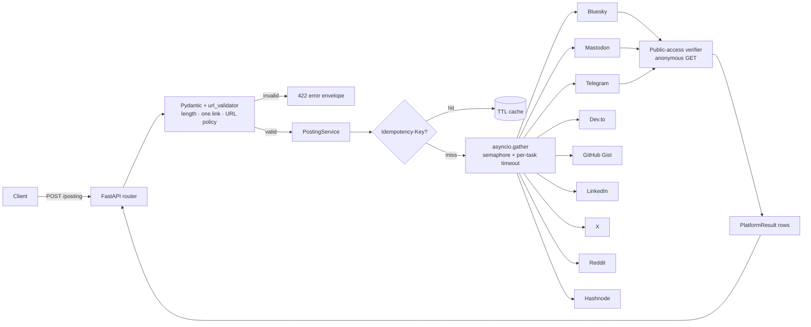

# Automated Multi-Platform Posting System

A FastAPI service that validates **one** short message and publishes it to **many** third-party
platforms through their official APIs — concurrently, with per-platform error isolation, retries,
timeouts and a verified public URL in every result row.

[](https://github.com/powerxranger/automated-multi-platform-posting/actions/workflows/ci.yml)


```
POST http://localhost:4000/posting
{ "message": "Check out our latest business platform ... https://example.com" }
```

---

## Contents

- [What it does](#what-it-does)
- [Architecture](#architecture)
- [Quickstart](#quickstart)
- [Configuration](#configuration)
- [Platform integrations](#platform-integrations)
- [API reference](#api-reference)
- [Validation rules](#validation-rules)
- [Sample requests and responses](#sample-requests-and-responses)
- [Tests](#tests)
- [Design decisions](#design-decisions)
- [Error handling](#error-handling)
- [Security](#security)
- [Limitations and roadmap](#limitations-and-roadmap)
- [Project structure](#project-structure)

---

## What it does

| Requirement | Implementation |
|---|---|
| One REST endpoint | `POST /posting` (plus `/platforms`, `/health`, `/validate`) |
| Message ≤ 200 chars | Normalised, then counted in characters (`message_too_long`) |
| Exactly one CTA link | Counted by URL extraction (`link_count`) |
| URL validation | scheme, hostname, TLD, port, embedded credentials, private/loopback IPs (`invalid_url`) |
| Platform selection internal | `ENABLED_PLATFORMS` env var — never a request field |
| ≥ 5 platforms, independent | 9 adapters; each has its own auth, payload and error mapping |
| One failure must not stop the rest | `asyncio.gather` + per-task timeout, retry and exception containment |
| Result per platform | platform, status, posted URL, public access, date, time, error |

### Why this passes the "real integration" bar

- **9 adapters, 5 different auth mechanisms**: JWT session (Bluesky), Bearer token (Mastodon),
  bot token (Telegram), static API key header (Dev.to), PAT (GitHub), OAuth2 (LinkedIn),
  OAuth 1.0a HMAC-SHA1 signed requests (X), password-grant OAuth2 (Reddit), GraphQL bearer (Hashnode).
- **`public_access` is measured, not assumed.** After publishing, the service fetches the URL
  *without credentials* and looks for login walls. When anonymous verification is impossible
  (LinkedIn, X) it reports `public_access: true` **with `public_access_verified: false`** instead of
  pretending.
- **Nothing is faked.** A platform without credentials is reported as *unavailable* in the response
  summary, never as a success. No mock data is ever returned by the real endpoint.

---

## Architecture



**Layering.** Adapters contain *only* platform specifics. The service contains *only*
orchestration. Validation is a set of pure functions. That means an adapter bug can never break
another platform, and every business rule is unit-testable without a network.

**Reliability defaults**: 15 s per-platform timeout, 5 concurrent posts, 1 retry for transient
failures only (429 / 5xx / timeout / connection error), exponential backoff with jitter, honouring
`Retry-After`.

---

## Quickstart

Requires **Python 3.11+**.

```bash
git clone https://github.com/powerxranger/automated-multi-platform-posting.git
cd automated-multi-platform-posting

python -m venv .venv
# Windows
.venv\Scripts\activate
# macOS / Linux
source .venv/bin/activate

pip install -r requirements.txt

# Windows: Copy-Item .env.example .env
cp .env.example .env
# ... fill in at least one platform's credentials, then:

uvicorn app.main:app --host 0.0.0.0 --port 4000
```

Open **http://localhost:4000/docs** for Swagger UI.

Check what is ready before demoing:

```bash
python scripts/check_env.py      # table of configured / missing credentials
curl http://localhost:4000/platforms
```

Publish:

```bash
curl -X POST http://localhost:4000/posting \
  -H "Content-Type: application/json" \
  -d '{"message":"Check out our latest business platform and grow your online visibility. https://example.com"}'
```

Docker (optional):

```bash
docker compose up --build
```

---

## Configuration

Every credential is optional. The service starts with none of them; `POST /posting` then returns
`503 NO_PLATFORMS_CONFIGURED` with a per-platform list of what is missing.

| Variable | Purpose | Default |
|---|---|---|
| `APP_TIMEZONE` | Timezone for `date` / `time` fields | `Asia/Kolkata` |
| `ENABLED_PLATFORMS` | Comma-separated ids to use; empty = all configured | *(empty)* |
| `REQUEST_TIMEOUT_SECONDS` | Per-platform deadline | `15` |
| `MAX_CONCURRENT_PLATFORMS` | Parallel posts | `5` |
| `MAX_RETRIES` | Retries for transient failures only | `1` |
| `PUBLIC_CHECK_ENABLED` | Verify posted URLs anonymously | `true` |
| `IDEMPOTENCY_TTL_SECONDS` | `Idempotency-Key` cache lifetime | `600` |
| `LOG_LEVEL` | JSON log level | `INFO` |

See [`.env.example`](.env.example) for the full annotated list.

---

## Platform integrations

Nine integrations, ordered by reliability (instant credentials → approval required). Adapters
without credentials are skipped and listed under `summary.platforms_unavailable`.

| # | Platform | Auth | Public post URL | Anonymous check |
|---|---|---|---|---|
| 1 | **Bluesky** | `createSession` → JWT | `bsky.app/profile/{handle}/post/{rkey}` | ✅ verified |
| 2 | **Mastodon** | Bearer token | `{instance}/@{user}/{id}` | ✅ verified |
| 3 | **Telegram** | Bot token (public channel admin) | `t.me/{channel}/{message_id}` | ✅ verified |
| 4 | **Dev.to** | `api-key` header | `dev.to/{user}/{slug}` | ✅ verified |
| 5 | **GitHub Gist** | Fine-grained PAT (`Gists`) | `gist.github.com/...` | ✅ verified |
| 6 | **LinkedIn** | OAuth2 `w_member_social` | `linkedin.com/feed/update/urn:li:share:...` | ➖ declared (login wall) |
| 7 | **X (Twitter)** | OAuth 1.0a user context | `x.com/i/web/status/{id}` | ➖ declared (login wall) |
| 8 | **Reddit** | OAuth2 password grant | `reddit.com/r/{sub}/comments/{id}` | ✅ verified |
| 9 | **Hashnode** | GraphQL bearer token | `{blog}.hashnode.dev/{slug}` | ✅ verified |

### Getting credentials (numbered, copy-paste friendly)

1. **Bluesky** — bsky.app → *Settings* → *App Passwords* → add one. Set `BLUESKY_HANDLE`
   (`you.bsky.social`) and `BLUESKY_APP_PASSWORD`. No developer account, no approval.
2. **Mastodon** — on any instance: *Preferences* → *Development* → *New application*, scope
   `write:statuses`. Set `MASTODON_INSTANCE_URL` and `MASTODON_ACCESS_TOKEN`.
3. **Telegram** — message `@BotFather` → `/newbot`. Create a channel, set a **public** `@username`,
   add the bot as **administrator** with post rights. Set `TELEGRAM_BOT_TOKEN`, `TELEGRAM_CHANNEL`.
4. **Dev.to** — *Settings* → *Extensions* → *DEV Community API Keys* → generate. Set `DEVTO_API_KEY`.
5. **GitHub Gist** — *Settings* → *Developer settings* → *Personal access tokens* → fine-grained
   token with **Gists: read & write**. Set `GITHUB_TOKEN`.
6. **LinkedIn** — [developers.linkedin.com](https://www.linkedin.com/developers/apps) → create app →
   request the **Share on LinkedIn** product (`w_member_social`). Set `LINKEDIN_ACCESS_TOKEN` and
   `LINKEDIN_AUTHOR_URN` (`urn:li:person:...`).
7. **X** — [developer.x.com](https://developer.x.com) → free tier → app with **Read and write**
   permission → *Keys and tokens* → OAuth 1.0a user context. Set the four `X_*` variables.
8. **Reddit** — [reddit.com/prefs/apps](https://www.reddit.com/prefs/apps) → *script* app. Set
   `REDDIT_CLIENT_ID`, `REDDIT_CLIENT_SECRET`, `REDDIT_USERNAME`, `REDDIT_PASSWORD`,
   `REDDIT_SUBREDDIT`, `REDDIT_USER_AGENT`.
9. **Hashnode** — *Account settings* → *Developer* → personal access token, plus your publication id.
   Set `HASHNODE_TOKEN`, `HASHNODE_PUBLICATION_ID`.

### Platforms deliberately not implemented

| Platform | Reason |
|---|---|
| Medium | Public write API was discontinued; no new tokens are issued |
| Threads, Pinterest, Facebook Pages | Require app review / business verification before publishing |
| Slack, Discord | Messages are not publicly readable without joining the workspace |
| Buffer / Ayrshare | Aggregators; the brief asks for each platform to be researched and integrated directly |

---

## API reference

### `POST /posting`

| | |
|---|---|
| Body | `{"message": string}` — `extra` fields rejected with `422` |
| Optional header | `Idempotency-Key: <string>` — same key within 10 min returns the cached response |
| `200` | One or more platforms published (`success: true` if ≥ 1 succeeded) |
| `422` | Validation failed — structured `fields[]` |
| `503` | No platform configured |
| `500` | Unexpected server error (never leaks internals) |

Response fields per result: **`platform`, `status`, `posted_url`, `public_access`, `date`, `time`,
`error`** — exactly as specified — plus a nested `meta` object with `http_status`, `latency_ms`,
`attempts`, `public_access_verified`, `timezone`, `post_id` and `checked_at_utc`.

### Other endpoints

| Endpoint | Purpose |
|---|---|
| `GET /health` | Liveness + how many platforms are configured |
| `GET /platforms` | Readiness report: configured, enabled, required-but-missing variables |
| `POST /validate` | Dry run of the validation rules (no publishing), always `200` |
| `GET /docs`, `GET /redoc`, `GET /openapi.json` | Interactive documentation |

---

## Validation rules

Applied to the whitespace-normalised message, in this order.

| Rule | Failure code | Example message |
|---|---|---|
| Not empty | `message_empty` | `Message must not be empty.` |
| ≤ 200 characters | `message_too_long` | `Message is 231 characters; the maximum is 200.` |
| Exactly one link | `link_count` | `Exactly one CTA link is required; none was found.` |
| Link is `http`/`https` | `invalid_url` | `The CTA link is invalid: only http and https URLs are supported.` |
| Hostname has a TLD | `invalid_url` | `... 'example' is not a valid top-level domain` |
| No embedded credentials | `invalid_url` | `... credentials embedded in the URL are not allowed` |
| No private / loopback host | `invalid_url` | `... private or reserved IP addresses are not publicly reachable` |
| Valid port | `invalid_url` | `... the URL contains an invalid port` |

Trailing punctuation is stripped (`(https://example.com).` → `https://example.com`), so prose can
contain the link naturally. Character counting is by Unicode code point, so emoji behave sanely.

---

## Sample requests and responses

### Publishing (`200`)

Shortened here; the full document is in
[`docs/sample_responses/illustrative-response.json`](docs/sample_responses/illustrative-response.json)
(it is generated by `scripts/generate_sample_response.py`, which swaps the adapters for test doubles
— see [Tests](#tests)).

```json
{
  "success": true,
  "request_id": "0f9c2f0f4b6a4d7e9c1a2b3c4d5e6f70",
  "message": "Check out our latest business platform and grow your online visibility. https://example.com",
  "summary": { "total": 7, "succeeded": 6, "failed": 1, "duration_ms": 514, "platforms_unavailable": [] },
  "results": [
    {
      "platform": "Bluesky",
      "status": "success",
      "posted_url": "https://bsky.app/profile/demo.bsky.social/post/3kexample",
      "public_access": true,
      "date": "2026-11-16",
      "time": "19:29:58",
      "error": null,
      "meta": {
        "http_status": 201, "latency_ms": 201, "attempts": 1,
        "public_access_verified": true, "timezone": "Asia/Kolkata",
        "post_id": "bluesky", "checked_at_utc": "2026-11-16T13:59:58+00:00"
      }
    },
    {
      "platform": "LinkedIn",
      "status": "success",
      "posted_url": "https://www.linkedin.com/feed/update/urn:li:share:7123456789/",
      "public_access": true,
      "date": "2026-11-16",
      "time": "19:29:58",
      "error": null,
      "meta": { "public_access_verified": false, "timezone": "Asia/Kolkata" }
    },
    {
      "platform": "X (Twitter)",
      "status": "failed",
      "posted_url": null,
      "public_access": false,
      "date": null,
      "time": null,
      "error": "Authentication failed",
      "meta": { "http_status": null, "attempts": 1 }
    }
  ],
  "replayed": false
}
```

### Validation error (`422`) — captured from a live run

```console
$ curl -s -X POST http://localhost:4000/posting -H "Content-Type: application/json" \
    -d '{"message":"no link"}'
{"success":false,"request_id":"c96bede6f094455382ba6db681347ec1",
 "error":{"code":"VALIDATION_ERROR",
          "message":"The request body is invalid. See the fields array for details.",
          "fields":[{"field":"message","code":"link_count",
                     "detail":"Exactly one CTA link is required; none was found."}]}}
```

### No credentials configured (`503`) — captured from a live run

```console
$ curl -s -X POST http://localhost:4000/posting -H "Content-Type: application/json" \
    -d '{"message":"Check out our platform https://example.com"}'
{"success":false,"request_id":"f8179d77dd62436e8af575a04eb76670",
 "error":{"code":"NO_PLATFORMS_CONFIGURED",
          "message":"No platform is configured. Fill in at least one set of credentials in .env (see .env.example) and restart the server.",
          "fields":[{"field":"Bluesky","code":"bluesky",
                     "detail":"missing credentials: BLUESKY_HANDLE, BLUESKY_APP_PASSWORD"}, ...]}}
```

### Health (`200`) — captured from a live run

```json
{
  "status": "ok",
  "version": "1.0.0",
  "environment": "local",
  "platforms_configured": 0,
  "time_utc": "2026-11-16T13:55:43+00:00"
}
```

More ready-to-run requests: [`requests.http`](requests.http) (VS Code REST Client) and
[`docs/postman_collection.json`](docs/postman_collection.json).

---

## Tests

```bash
pip install -r requirements-dev.txt
pytest --cov=app --cov-report=term-missing
```

```
102 passed
TOTAL   974 statements   45 missed   93% coverage
```

The suite makes **no network calls** — `httpx.MockTransport` stands in for every API.

| Area | What is asserted |
|---|---|
| Validation (25 tests) | 200 vs 201 chars, 0 / 1 / 2 links, duplicate links, `ftp://`, localhost, private IPs, missing TLD, embedded credentials, bad port, trailing punctuation, unicode, whitespace normalisation, title derivation |
| Orchestration (16) | all succeed, **one fails and the rest still publish**, all fail, unavailable platforms, `ENABLED_PLATFORMS`, retryable vs non-retryable errors, retry counting, timeout isolation, real parallelism (timing), idempotency replay, public-access verification |
| Adapters (24) | request payload shape per platform (including Bluesky's UTF-8 byte offsets), URL construction, 401/403/404/422/429/500 mapping, `Retry-After`, network timeouts, non-JSON responses, Telegram `ok:false`, Reddit token caching |
| HTTP contract (22) | status codes, error envelope shape, `extra_forbidden`, malformed JSON, `X-Request-ID` echo, 404 envelope, OpenAPI content, no credentials in responses |
| Security / OAuth1 (9) | token redaction in logs, errors and API output; HMAC-SHA1 header structure and determinism |

CI runs `ruff check`, `ruff format --check`, `mypy app` and the suite with
`--cov-fail-under=90` on Python 3.11 and 3.12.

---

## Design decisions

1. **Platform selection is server-side only.** The brief says selection is handled internally, so
   `platforms` is *not* a request field (it is rejected as `extra_forbidden`). Operators choose via
   `ENABLED_PLATFORMS`.
2. **Partial success returns `200`.** The product requirement is "publish where you can"; a `5xx`
   would make retries ambiguous. `success` means *at least one* platform published — matching the
   brief's example, which pairs `success: true` with one failed row. `summary` carries the detail.
3. **Only transient failures are retried.** 429 / 5xx / timeout / connection error are retried once;
   401 / 403 / 422 are not, because a bad token or a rejected payload fails identically the second
   time — retrying would waste a platform quota and delay the response.
4. **`public_access` is verified, not assumed.** A successful publish followed by a deleted post
   would otherwise be reported as publicly accessible. Where verification is impossible, the result
   says so (`public_access_verified: false`) rather than inventing a boolean.
5. **No link reachability check in the hot path.** It would make every request slower and flakier
   (many sites block bots). It is available separately through `POST /validate` if needed.
6. **Idempotency via header, not payload.** Protects against double-clicks in `/docs` and client
   retries without changing the specified request schema.
7. **Adapters raise, the service decides.** Keeps retry/timeout/aggregation policy in one place and
   makes every adapter a small, auditable class.

---

## Error handling

| Code | Meaning | Retried |
|---|---|---|
| `auth_failed` | 401/403 — bad or expired credentials | no |
| `rate_limited` | 429 — respects `Retry-After` (capped at 3 s) | yes |
| `timeout` | Per-platform deadline exceeded | yes |
| `network` | Connection error or 5xx | yes |
| `platform_rejected` | Any other 4xx, or a platform-specific rejection | no |
| `unexpected` | Malformed response / adapter contract violation | no |
| `config_missing` | Credentials absent — platform is skipped, not failed | — |

Response-level codes: `VALIDATION_ERROR` (422), `NO_PLATFORMS_CONFIGURED` (503), `HTTP_404`,
`INTERNAL_ERROR` (500). Every response echoes `X-Request-ID`.

---

## Security

- Credentials come from environment variables only; `.env` is gitignored from the first commit.
- A redaction filter registers every configured secret and scrubs it from logs, adapter error
  messages and HTTP responses (covered by tests).
- `.pre-commit-config.yaml` includes `gitleaks` and `detect-private-key`.
- Publishing is low-volume by design: one post per platform per request, no loops, no scheduling.
  The tool is a demonstration, not a spam engine — respect each platform's automation policy.
- Docker image runs as a non-root user.

---

## Limitations and roadmap

Honest list of what this is **not**:

- **In-memory idempotency and no persistence.** A restart forgets keys and post history. Production
  version: Redis/DynamoDB with a unique constraint, plus a `posting_events` table.
- **No queue.** A long-running request holds the caller open for the slowest platform. Production
  version: enqueue per-platform jobs, return `202` with a status URL.
- **No circuit breaker per platform.** A consistently failing platform still costs one attempt per
  request. Production version: per-platform breaker with a cool-down.
- **X free tier is rate-limited** and LinkedIn app review is manual, so those two adapters may be
  listed as unavailable in a fresh environment.
- **Reddit link posts can be removed by subreddit spam filters.** That shows up honestly as
  `platform_rejected` with the platform's message.
- **No media, threads or scheduling** — text-only, single post, immediate, as specified.

---

## Project structure

```
app/
├── main.py                  # app factory, lifespan, exception handlers, request-id middleware
├── api/routes.py            # /posting, /platforms, /health, /validate
├── schemas.py               # Pydantic request/response models
├── config.py                # typed settings (pydantic-settings)
├── errors.py                # error taxonomy + HTTP → domain mapping
├── logging.py               # JSON logs with secret redaction
├── platforms/
│   ├── base.py              # PlatformAdapter contract + uniform HTTP helper
│   ├── registry.py          # reliability-ordered adapter list
│   ├── oauth1.py            # RFC 5849 HMAC-SHA1 signer (X)
│   └── bluesky.py · mastodon.py · telegram.py · devto.py
│       github_gist.py · linkedin.py · x_twitter.py · reddit.py · hashnode.py
└── services/
    ├── posting_service.py   # concurrency, timeouts, retries, idempotency, aggregation
    ├── url_validator.py     # pure validation rules
    └── public_access.py     # anonymous reachability / login-wall detection

tests/           102 tests, no network
scripts/         check_env.py · smoke_test.py · generate_sample_response.py
docs/            postman_collection.json · sample_responses/ · screenshots/
```

---

## License

MIT — see [LICENSE](LICENSE).
